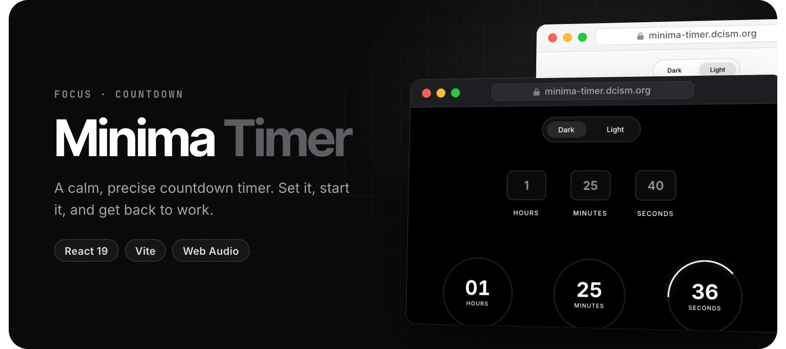
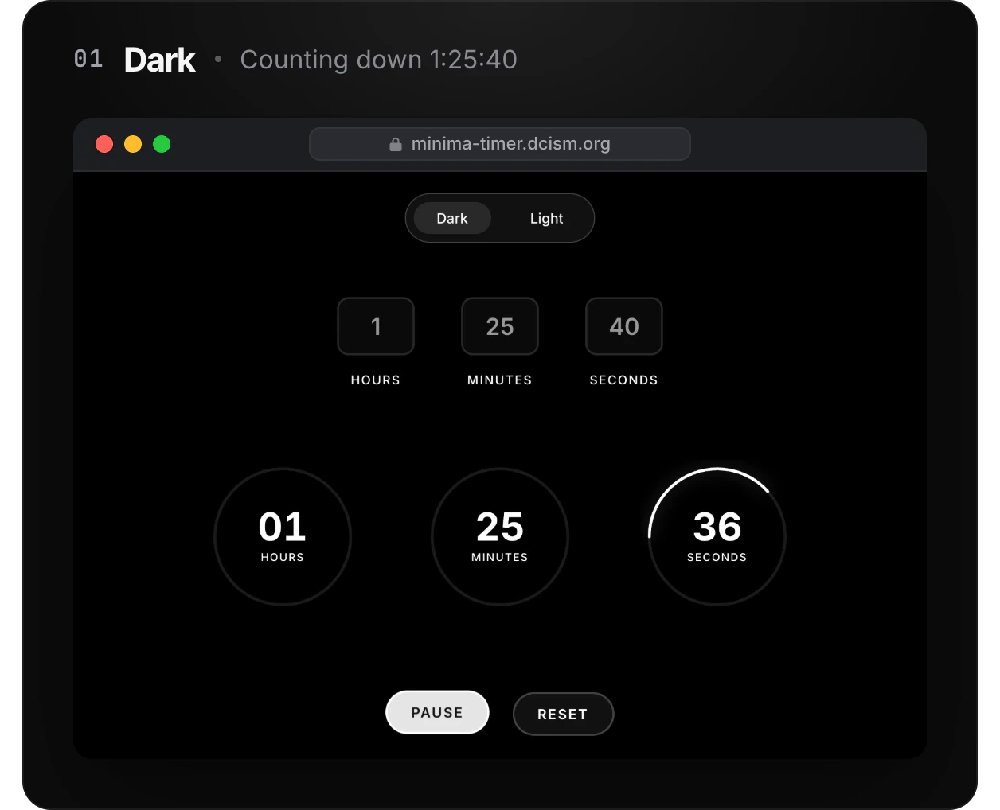
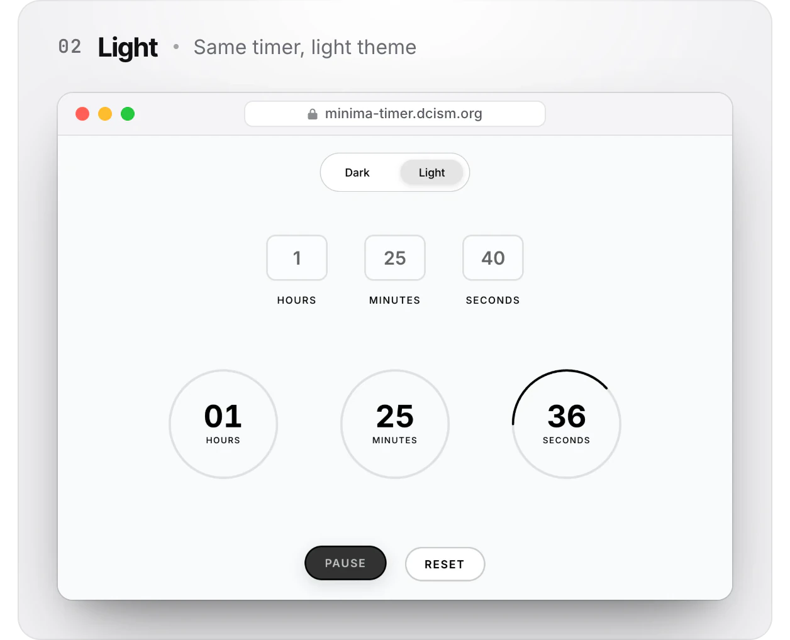

<div align="center">



<br />

<a href="https://minima-timer.dcism.org/"></a>


</div>

<br />

**Minima Timer** is a countdown timer that stays out of the way. Enter hours, minutes and
seconds, press start, and three rings count down with you. When time is up, a soft bell plays.

## Screenshots

<p align="center">
  <!--
  -->
</p>

## Features

- **Hours, minutes and seconds** inputs, each with its own circular progress ring
- **Start, pause, resume and reset**; resuming picks up where you paused
- **No drift.** Remaining time is computed from timestamps rather than by counting ticks, so a
  busy tab does not slow the clock down
- **Light and dark themes**, switchable from the top of the page
- **A synthesised bell.** Three short sine "tings" generated with the Web Audio API, so there is
  no audio file to load

## Getting started

```bash
npm install
npm run dev
```

| Command | What it does |
| --- | --- |
| `npm run dev` | Start the dev server |
| `npm run build` | Build for production |
| `npm run preview` | Preview the production build |
| `npm run lint` | Run ESLint |

> [!NOTE]
> The bell uses the Web Audio API, and some browsers only allow audio after a user gesture on
> the page.

## Project structure

```text
src/App.jsx        timer logic and UI
src/App.css        component styles
src/index.css      base styles and resets
src/bellSound.js   Web Audio bell
```

## License

[MIT](LICENSE) © 2026 Kent Jester Gatchalian

<br />

<p align="center"><sub>Built in Cebu by <a href="https://github.com/kntucky-y">Kent Jester Gatchalian</a></sub></p>
