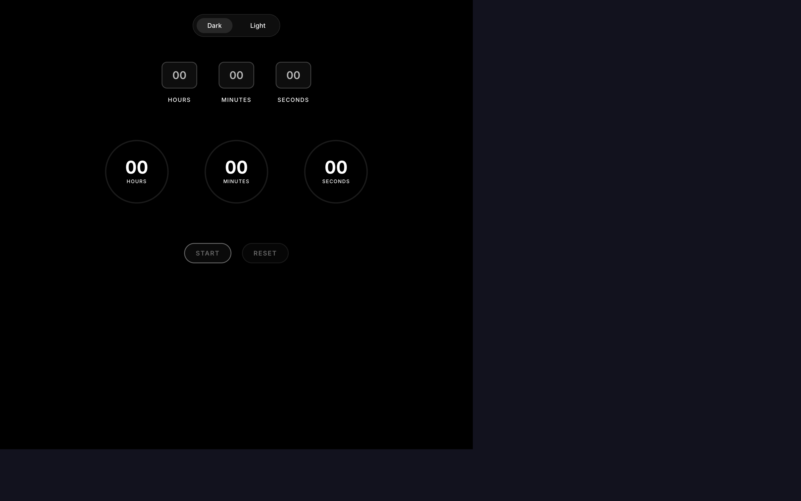

<div align="center">

# Minima Timer

### A calm countdown timer for focused sessions.

<p>
  <a href="https://minima-timer.dcism.org"></a>
  <a href="https://github.com/kntucky-y/Minima-Timer"></a>
</p>



</div>

## Overview

Minima Timer is a small, focused countdown timer built around a clean circular
display. It keeps the controls simple so the timer can stay in the background
while you work, study, or take a deliberate break.

Try the [live website](https://minima-timer.dcism.org). The screenshot above
is a capture of the deployed app in its default dark theme.

## Features

- Hours, minutes, and seconds input
- Start, pause, resume, and reset controls
- Circular progress indicators for each time unit
- Light and dark themes
- Optional Web Audio bell when a session completes
- Responsive, minimal interface

## Product design

The interface is intentionally restrained: one clear timer, a small set of
state-aware controls, and visual progress that can be understood at a glance.
The circular indicators provide feedback without adding a dashboard around the
thing you came to do.

## Tech stack

- React 19
- Vite with Rolldown
- JavaScript
- ESLint
- Web Audio API

## Getting started

```bash
npm install
npm run dev
```

Open the local URL printed by Vite.

## Scripts

| Command | Purpose |
|---|---|
| `npm run dev` | Start the development server |
| `npm run build` | Create a production build |
| `npm run preview` | Preview the production build |
| `npm run lint` | Run ESLint |

## Project structure

```text
src/App.jsx       Timer logic and UI
src/App.css       Component styles
src/index.css     Base styles and resets
src/bellSound.js  Web Audio bell implementation
```

## Audio note

Some browsers require a user gesture before Web Audio can play. Start or
interact with the timer once if the completion bell is unavailable.

## Contributing and license

Issues and pull requests are welcome. Keep changes focused and include a clear
description of the problem and solution.

MIT. See [LICENSE](LICENSE).
